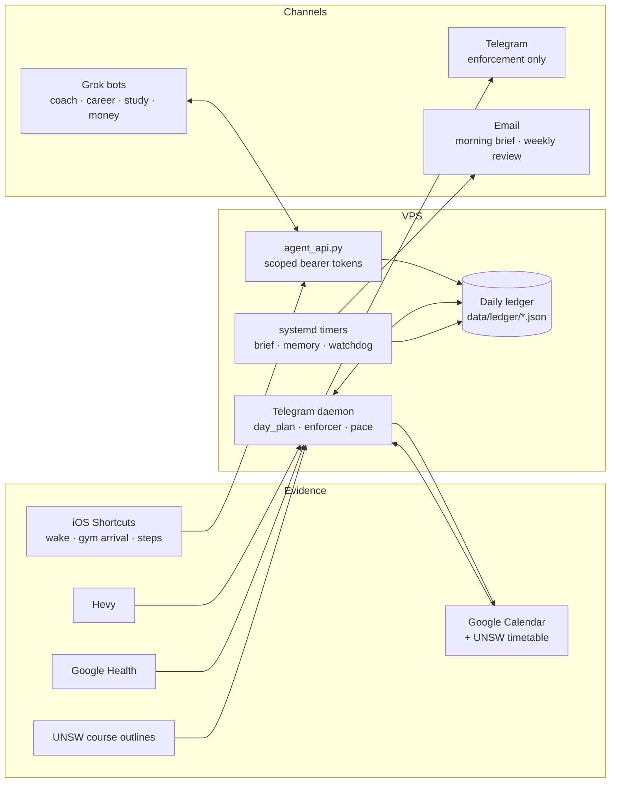

# Jarvis

Vanam, formerly Jarvis; internals keep the jarvis name.

A personal assistant that runs my day as a student at UNSW. It plans study
time around classes, enforces the gym, tracks steps and deadlines, and sends
a daily brief. It checks what actually happened against real data (Hevy,
Google Health, the calendar, phone events) instead of asking me whether I did
something.

It runs on a small VPS for about $3 a month in API costs, and has about 400 tests.

## The loop

Most personal dashboards report. Jarvis is built around a loop:
**commit → verify → escalate → adapt.**

- **Commit.** At 05:30 it builds the day: a gym slot, a step target, and
  study and lecture blocks sized from weekly targets. The blocks are placed in
  free time and written to Google Calendar.
- **Verify.** Evidence comes from data, not self-report:
  - a phone alarm and gym geofence (iOS Shortcuts)
  - workout logs (Hevy API)
  - step counts (Apple Health and Fitbit, reconciled)
  - done / partial / no replies when each study block ends
- **Escalate.** A wake sequence on Telegram ("reply up", a photo, "leave
  now"), pace nudges when steps fall behind, and debt for misses. A skipped
  session owes a make-up within 48 hours, and a step shortfall carries to the
  next day.
- **Adapt.** Excuses go through a gate that checks the data. Under 6 hours of
  sleep moves the session to the evening. A genuinely full calendar allows a
  shorter session. Anything else is rejected. One-off schedule changes
  re-plan the rest of the day.

## Architecture



**Three channels, each with one job.**
- **Telegram** carries real-time enforcement only: the wake sequence, step
  nudges, block check-ins and debt.
- **Grok bots** handle conversation, including the 21:00 evening check-in.
  They call the agent API with tokens scoped to their routes.
- **Email** carries the 07:05 morning brief and the Sunday weekly review.

**The ledger is the record.** Each day is one JSON file holding that day's
commitments, every evidence event, and the debt carried in. Writes hold a
file lock for the whole read-modify-write cycle and replace the file
atomically, because the daemon, the API and the timers all touch the same
files. Enforcement state lives in the ledger, so a restart resumes mid-sequence.

## Design choices

- **Python computes every number; Claude writes prose.** The morning brief
  and the weekly review are rendered from data in a fixed dark template.
  Claude writes only a short note and one push, returned as JSON. That keeps
  the numbers trustworthy and the output to about 80 words. Each daily feature
  makes at most one small Claude call.
- **Unknown is not a failure.** A missing step reading is unknown, not
  "behind". If Hevy is unreachable, the day doesn't close as a miss. A day the
  enforcer never ran is graded "unenforced", not "missed".
- **The calendar reflects reality.** A lecture block can only start after
  that lecture has happened, because recordings don't exist before it. Jarvis
  tags its own calendar events, so a re-plan never touches anything else.
- **The training week follows the workout split,** not the ISO week. A session
  logged on the rest day before a training day counts for that day.
- **Fail soft.** Every optional integration is imported defensively. A broken
  module drops one section of the brief instead of stopping it.

## Modules

| Area | Files |
|---|---|
| Day planning | `day_plan.py`, `course_outlines.py`, `course_schedule.py`, `uni_timetable.py`, `jarvis_calendar.py` |
| Enforcement | `ledger.py`, `enforcer.py`, `pace.py`, `hevy.py`, `google_health.py` |
| Check-in and goals | `evening_checkin.py`, `areas.py`, `term_context.py`, `study_tracker.py` |
| Briefs | `morning_brief.py`, `weekly_review.py`, `email_template.py`, `voice.py` |
| Channels and API | `jarvis_telegram.py`, `agent_api.py`, `live_spend.py` |
| Money | `finance_tracker.py`, `subscription_audit.py`, `reselling_tracker.py` |
| Memory | `memory_system.py`, `jarvis_mem0.py` |
| Operations | `watchdog.py`, `deploy/`, `.github/workflows/deploy.yml` |

Further documentation:
- `docs/REWORK.md`: the design spec for the commit → verify loop
- `docs/API.md`: the agent API
- `docs/grok_bots.md`: instructions for each Grok bot

## Running it

Python 3.10+. Configuration is environment variables; see `.env.example`.

```bash
python -m venv venv && venv/bin/pip install -r requirements.txt
cp .env.example .env            # fill in keys
python morning_brief.py --setup # Google OAuth, once
venv/bin/python -m pytest -q
```

**Useful commands:**

```bash
python morning_brief.py --preview /tmp/brief.html   # render the brief without sending
python weekly_review.py --preview /tmp/review.html
python day_plan.py --dry-run                        # today's plan, written nowhere
python agent_api.py --serve
```

**Deployment.** A push to `main` runs a GitHub Actions job that SSHes into the
VPS. The SSH key is restricted to one command, `deploy/vps-deploy.sh`, which
fast-forwards the checkout and restarts the long-running services. The agent
API binds to localhost and is exposed over HTTPS through Tailscale Funnel.
Personal data (`term_context.json`, `profile.md`, everything under `data/`)
is gitignored and lives only on the VPS.
